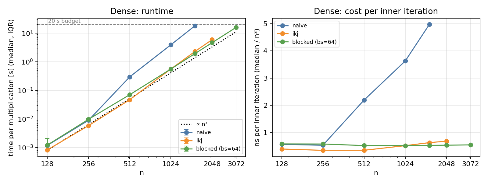
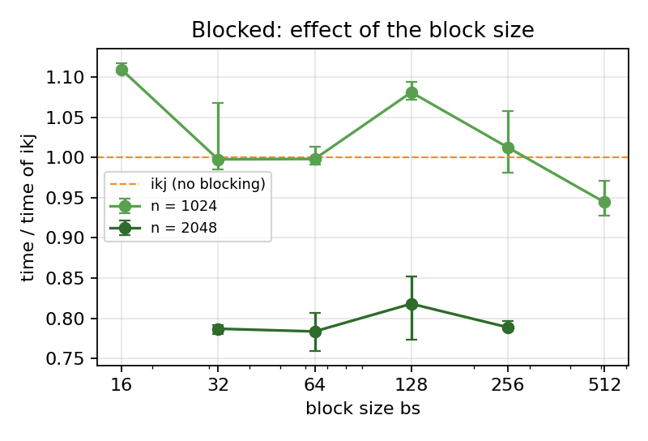
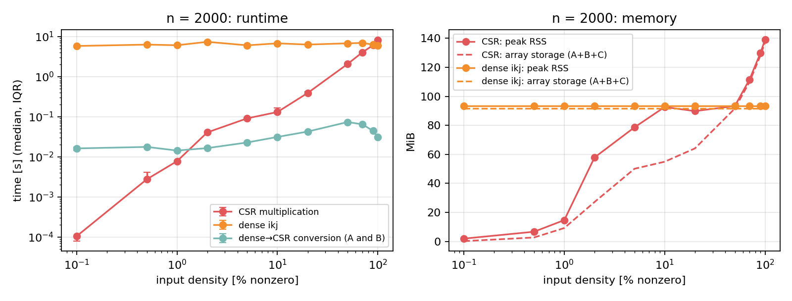

# Assignment 2 — Optimised Dense Matrix Multiplication and Sparse (CSR) Multiplication in C

<p class="meta">Big Data · Grado en Ciencia e Ingeniería de Datos · ULPGC 2026-2027 · Individual Assignment 2 · Andrea Patruno · October 2026</p>

<p class="meta">GitHub repository (code, raw data, scripts): <a href="https://github.com/andreapatruno1/Assignment2_BD">https://github.com/andreapatruno1/Assignment2_BD</a></p>

**Abstract.** We ask how loop interchange (i-k-j with hoisting) and cache blocking change the Assignment 1 C triple loop, and for which densities a CSR multiplication beats a dense method. All methods run on the same inputs (median of 5 repetitions) and give identical results. i-k-j is 6.3–7.9× faster than the baseline from n = 512; blocking adds 16–22 % only for n ≥ 1536. At n = 2000, CSR wins up to about 90 % density and loses at 100 %. Conclusions hold for this machine and these inputs.

## 1. Introduction and objective

Assignment 1 showed that the basic triple loop slows down much more than n³ once the matrices leave the cache. Following Bentley's rules ("do it less", "do it better") and the course topic *memory layout and locality*, this study changes how the same arithmetic is executed (Part A) and avoids work on zero entries (Part B).

**Research questions.**
**(A)** How do loop interchange and cache blocking change the runtime and memory of dense multiplication as n grows?
**(B)** For which tested densities does a CSR multiplication beat a dense method on the same logical inputs, and what reduces its advantage?

**Hypotheses (stated before measuring).** H1: i-k-j is faster than i-j-k as soon as B exceeds the cache, because it traverses rows (stride 1) instead of columns (stride n). H2: blocking helps only when the working set of i-k-j exceeds the cache. H3: CSR wins at low density, but its indexing overhead makes it lose close to 100 % density.

*Factors changed:* n and method (Part A); density and representation (Part B). *Outcomes:* time per multiplication and peak memory.

## 2. Background

Matrices are row-major (`A[i][j]` at `i*n + j`): a row is contiguous, a column has stride 8n bytes, and a 64-byte cache line holds 8 doubles [1]. Loop interchange (i-k-j) makes the inner loop walk rows of B and C, with the loop-invariant `A[i][k]` hoisted out [1]; cache blocking applies the same body to bs × bs tiles so that a tile of B is reused while it is in cache [3]. Both keep the 2n³ flops and change only the memory access order. CSR stores, per nonzero, its value (8 B) and column (4 B), plus n + 1 row pointers [4]; the row-by-row product (Gustavson [2]) does ≈ d²n³ work for uniform density d, versus n³ for a dense method.

## 3. Methodology

### 3.1 Implementations (one C program, `src/matmul2.c`)

`naive` is the Assignment 1 loop, unchanged; `ikj` and `blocked` (bs = 64, sweep 16–512) are the optimised dense methods; `csr` is own code (no library). In Part B, `ikj` is the dense comparator and `convert` (dense → CSR of A and B) is timed separately.

```c
/* naive */   for i: for j: { s = 0; for k: s += a[i*n+k] * b[k*n+j]; c[i*n+j] = s; }
/* ikj   */   for i: for k: { aik = a[i*n+k]; bk = &b[k*n]; for j: ci[j] += aik * bk[j]; }
/* blocked */ for ii, kk, jj (step bs): for i in block: for k in block: { aik = ...; for j in block: ci[j] += aik*bk[j]; }
/* csr   */   for i: for p in row i of A: { k = colA[p]; for q in row k of B: { j = colB[q];
                  if (mark[j] != i) { mark[j] = i; acc[j] = valA[p]*valB[q]; cols[cnt++] = j; } else acc[j] += valA[p]*valB[q]; } }
```

All methods are sequential and scalar: compiled with `gcc -O2 -fno-tree-vectorize` (SIMD is left to Assignment 3), numeric type float64.

### 3.2 Inputs, environment and timing

- **Dense inputs (Part A):** the Assignment 1 generator, unchanged (`scripts/gen_inputs.py`): NumPy PCG64, seed 42 + n, uniform [-1, 1), raw little-endian float64 files. Sizes 128, 256, 512, 1024, 1536, 2048, 3072.
- **Sparse inputs (Part B):** generated inside the program with splitmix64 (seed 2026 for A, 2027 for B): each entry is nonzero independently with probability d (uniform positions), value uniform [-1, 1). The same generator writes either the dense array or the CSR arrays directly, so both methods receive the **same logical matrices** (checked in the tests). n = 2000 with densities 0.1, 0.5, 1, 2, 5, 10, 20, 50, 70, 90, 100 %; n = 4000 (0.1, 1, 5 %) and n = 10,000 (0.1, 0.5 %) for CSR scale.
- **Environment:** Intel Core i7-1255U laptop, Ubuntu 22.04.5 virtual machine (Hyper-V) with 2 logical CPUs and 3.8 GiB RAM; caches seen by the VM: L1d 48 KiB, L2 1.25 MiB, L3 12 MiB. GCC 11.4.0. Single-threaded code. Details in `results/environment.txt`. This is a different environment from Assignment 1 (WSL2, GCC 15.2), so the baseline is re-measured here and no number is compared across the two assignments.
- **Timer boundary (kernel only):** `clock_gettime(CLOCK_MONOTONIC)` around the multiplication. Input loading/generation and allocation of the dense output are outside; zeroing C (ikj, blocked) is inside. For CSR the timer includes the construction of the output CSR (allocation and growth of its arrays), because it is part of the method. Conversion dense → CSR is timed in a separate run and **not** added to the CSR time.
- **Protocol:** 1 warm-up run (not reported) + 5 measured repetitions per configuration; batches of runs for n = 128 (time per multiplication reported); each configuration runs in its own process. Every result is consumed by a checksum. Reported: median and IQR; all raw values are in `results/raw_*.csv`.
- **Budgets (fixed in advance):** 20 s for one multiplication (as in Assignment 1), enforced with `alarm()`; a timeout is recorded in `results/limits.csv`, never as a time. Memory budget 3 GB. Larger sizes are not attempted after a timeout.
- **Memory metrics:** (1) peak resident set size `VmHWM` of the process (`/proc/self/status`); (2) analytical array storage: dense 3·8n² bytes, CSR Σ(12·nnz + 4(n+1)) over A, B, C. They are different quantities and are reported separately.

### 3.3 Correctness

`matmul2 test` (`results/correctness.csv`): known 2×2 product, A·I = A and A·0 = 0 (n = 1, 7, 67, 130, not multiples of bs), random inputs vs the baseline, CSR vs the baseline at densities 0–100 %. Tolerance 10⁻¹² absolute + 10⁻¹² relative. All tests pass with maximum difference **0**: every method adds the k terms of C[i][j] in the same order, so results are bitwise identical (benchmark checksums are identical too).

## 4. Results

### 4.1 Part A — dense optimisations

**Table 1.** Median time per multiplication [s] (IQR in brackets), 5 repetitions; speed-up = median naive / median method.

| n | naive | ikj | blocked (bs=64) | speed-up ikj | speed-up blocked | blocked / ikj |
|---|---|---|---|---|---|---|
| 128 | 0.00119 (0.00001) | 0.00083 (0.00001) | 0.00122 (0.00099) | 1.44 | 0.97 | 1.47 |
| 256 | 0.00895 (0.00086) | 0.00582 (0.00024) | 0.00970 (0.00162) | 1.54 | 0.92 | 1.67 |
| 512 | 0.294 (0.019) | 0.0468 (0.0034) | 0.0701 (0.0019) | 6.29 | 4.20 | 1.50 |
| 1024 | 3.89 (0.09) | 0.557 (0.046) | 0.556 (0.012) | 6.99 | 7.00 | 1.00 |
| 1536 | 18.0 (0.31) | 2.28 (0.13) | 1.92 (0.07) | 7.90 | 9.38 | 0.84 |
| 2048 | timeout > 20 s | 5.87 (0.002) | 4.60 (0.28) | – | – | 0.78 |
| 3072 | not attempted | timeout > 20 s | 15.9 (0.44) | – | – | – |

**Largest feasible size (20 s):** naive 1536, ikj 2048, blocked 3072 (largest attempted: 2048, 3072, 3072).
**Memory:** peak RSS equals the array storage plus ≈ 1.7 MiB for all three methods (e.g. 97.7 MiB vs 96 MiB at n = 2048): the optimisations change the access order, not the memory used.

<figure><figcaption>Figure 1. Left: median time (IQR bars) vs n, log-log, dotted line ∝ n³. Right: median / n³, i.e. cost of one inner iteration.</figcaption></figure>

<figure><figcaption>Figure 2. Blocked time relative to ikj for block sizes 16–512 (n = 1024) and 32–256 (n = 2048).</figcaption></figure>

### 4.2 Part B — sparse vs dense at n = 2000

**Table 2.** Median time [s] (5 repetitions) and peak RSS of CSR. Output density = nnz(C)/n². Dense ikj RSS is 93.2 MiB at every density.

| input density | output density | CSR [s] | dense ikj [s] | ikj / CSR | convert [s] | RSS CSR [MiB] |
|---|---|---|---|---|---|---|
| 0.1 % | 0.19 % | 0.000105 | 5.79 | 55,102 | 0.016 | 1.9 |
| 0.5 % | 4.9 % | 0.00276 | 6.27 | 2,272 | 0.018 | 6.7 |
| 1 % | 18.1 % | 0.00779 | 6.05 | 776 | 0.014 | 14.7 |
| 2 % | 55.2 % | 0.0406 | 7.35 | 181 | 0.017 | 57.9 |
| 5 % | 99.3 % | 0.0911 | 6.02 | 66 | 0.023 | 78.6 |
| 10 % | 100 % | 0.131 | 6.74 | 52 | 0.031 | 92.6 |
| 20 % | 100 % | 0.390 | 6.28 | 16 | 0.043 | 89.8 |
| 50 % | 100 % | 2.06 | 6.75 | 3.3 | 0.074 | 93.3 |
| 70 % | 100 % | 4.00 | 6.92 | 1.7 | 0.065 | 111.6 |
| 90 % | 100 % | 6.09 | 6.24 | 1.02 | 0.044 | 129.9 |
| 100 % | 100 % | 8.17 | 5.95 | 0.73 | 0.031 | 139.1 |

IQRs are in `results/summary_sparse.csv`; at 90 % the IQRs of CSR (0.03 s) and ikj (0.53 s) overlap, so the two are not distinguishable there.

<figure><figcaption>Figure 3. n = 2000. Left: time vs input density (log-log). Right: peak RSS (solid) and analytical array storage A+B+C (dashed).</figcaption></figure>

**Larger sizes (CSR only feasible).** n = 4000, 1 %: CSR 0.044 s, output density 33 %, RSS 66 MiB; dense ikj **timed out** (> 20 s). n = 10,000: CSR 0.013 s at 0.1 % and 0.20 s at 0.5 % (output density 22 %, RSS 267 MiB). A dense method at n = 10,000 would need 3·8·10⁸ B = 2.4 GB of arrays alone; it was not attempted.

## 5. Discussion

**(A) Dense optimisations.**

- *Naive* follows n³ only up to n = 256 (×7.5 from 128 to 256), then jumps ×33 from 256 to 512 and its cost per iteration grows from 0.53 to 5.0 ns (Fig. 1). At n = 512, B (2 MiB) no longer fits in L2 (1.25 MiB): the inner loop reads B down a column, one useful double per 64-byte line, and the line is evicted before its other 7 doubles are used.
- *ikj* removes this: the inner loop reads B and C along rows (stride 1), so all 8 doubles of each line are used. Its time grows ×8.0 from 256 to 512 (cubic) and it is 6.3–7.9× faster than naive (H1 confirmed). Its cost per iteration is stable (0.35 ns) up to n = 512 and rises to 0.52 ns at n = 1024 and 0.63–0.68 ns at n = 1536–2048, as B (8, 18, 32 MiB) approaches and then exceeds the 12 MiB L3: for every row i the whole B is streamed again, from RAM once it no longer fits.
- *Blocked* keeps a 64×64 tile of B (32 KiB) in cache while it is reused by 64 rows, so its cost per iteration stays constant (0.52–0.58 ns) from 128 to 3072. It is 16–22 % faster than ikj at n ≥ 1536 and is the only method that fits n = 3072 in the budget. When everything already fits in cache (n ≤ 512) it is *slower* than ikj (×1.5–1.7): extra loop levels, inner loops of only 64 iterations and C rows re-read for each kk are overhead with nothing to gain (H2 confirmed).
- *Block size* (Fig. 2): at n = 2048 every bs from 32 to 256 gives 0.78–0.82 of the ikj time — all these tiles (8–512 KiB) fit in L2, so the exact value is not critical; at n = 1024 (B = 8 MiB, still below L3) blocking changes the time by −6 % to +11 % depending on bs, with no clear gain.

**(B) Sparse vs dense.**

- Dense ikj does the same n³ work at every density: its time stays between 5.8 and 7.4 s (variation between separate processes, not a trend). CSR work is ≈ d²n³, so its advantage shrinks quadratically with density: 776× at 1 %, 52× at 10 %, 3.3× at 50 % (H3 confirmed).
- *Where CSR loses.* At 50–100 % one CSR term costs ≈ 1.0 ns (8.17 s / 8·10⁹ terms at 100 %) against ≈ 0.75 ns for one dense iteration, because each term needs index reads (`colA`, `colB`, `rowptr`), the marker test and a scattered access to `acc[j]`. The model d² · 1.0 ns = 0.75 ns gives a break-even near 85–87 % density, consistent with the measured tie at 90 % and the loss at 100 % (0.73×).
- *Output fill-in.* An entry of C is nonzero with probability 1 − (1 − d²)ⁿ: 18 % for d = 1 % at n = 2000, 33 % at n = 4000 and ≈ 100 % from d = 5 % (Table 2, matches the measured nnz). So the output density depends on n as well as on d, and the output quickly becomes dense: from 10 % input density CSR writes a full matrix with 12 B per entry instead of 8 B. **The percentage of zeros alone does not determine the result.**
- *Memory.* CSR uses far less memory at low density (1.9 vs 93 MiB at 0.1 %) but more above 50 % (139 vs 93 MiB at 100 %), because of the 4-byte column index stored with each value. Between 2 % and 20 % RSS exceeds the array storage (58 vs 27 MiB at 2 %) because the output arrays grow by doubling (`realloc`), so up to half of the reserved capacity is unused.
- *Conversion cost.* Building CSR from a dense matrix must scan all n² entries, so it costs 14–74 ms whatever the density. At d ≤ 1 % this is **more than the CSR multiplication itself** (14 ms vs 7.8 ms at 1 %): if the data arrive in dense form, the conversion dominates.

**Limitations.** Virtual machine with 2 logical CPUs on a laptop (turbo and background activity are not controlled; ikj at n = 2000 varies ±12 % between processes). Hardware performance counters are not readable here (`perf_event_paranoid = 4`, no root), so the cache explanations are supported by the timing pattern and the cache sizes, not by measured misses. One seed per sparse configuration and only uniformly random sparsity (banded or clustered matrices could behave differently). The Part B dense comparator is ikj; blocked was ≈ 20 % faster at n = 2048 and would move the break-even somewhat lower. CSR output columns are not sorted inside a row. All code is scalar (`-fno-tree-vectorize`).

## 6. Conclusions

Within the tested scope (C, float64, sequential, this VM): (1) changing only the memory access order (i-k-j) gives a 6–8× speed-up over the Assignment 1 loop; (2) cache blocking adds 16–22 % only when B exceeds L3 and is slower for small matrices; (3) CSR beats the dense method up to about 90 % density at n = 2000, but output fill-in, index overhead, 12 B per entry and the dense-to-CSR conversion reduce its advantage. Open: confirming the cache explanations with hardware counters and testing structured sparsity.

## References

[1] Course material, *Monitoring and Performance Engineering* — Lectures (Bentley's rules) and Applications (hoisting, loop optimisations, memory layout and locality), Big Data, ULPGC, 2026. https://mltechdrawer.github.io/BIGDATA/

[2] F. G. Gustavson, "Two fast algorithms for sparse matrices: multiplication and permuted transposition," *ACM Trans. Math. Softw.*, vol. 4, no. 3, pp. 250–269, 1978.

[3] M. S. Lam, E. E. Rothberg, M. E. Wolf, "The cache performance and optimizations of blocked algorithms," in *Proc. ASPLOS IV*, 1991, pp. 63–74.

[4] Y. Saad, *Iterative Methods for Sparse Linear Systems*, 2nd ed. SIAM, 2003, Sec. 3.4 (storage schemes).

[5] A. Patruno, Assignment 1 — Basic matrix multiplication in Python, Java and C, 2026. https://github.com/andreapatruno1/Assignment1_BD

## Reproducibility materials

Code, raw measurements (`results/raw_*.csv`), timeouts, correctness results, analysis scripts and exact commands are in the GitHub repository above (README).

**Use of generative AI.** Claude (Anthropic) was used to help write the benchmark scripts and to revise the English of this report. All measurements were produced by running the code; the author checked the code, the results and the references.
